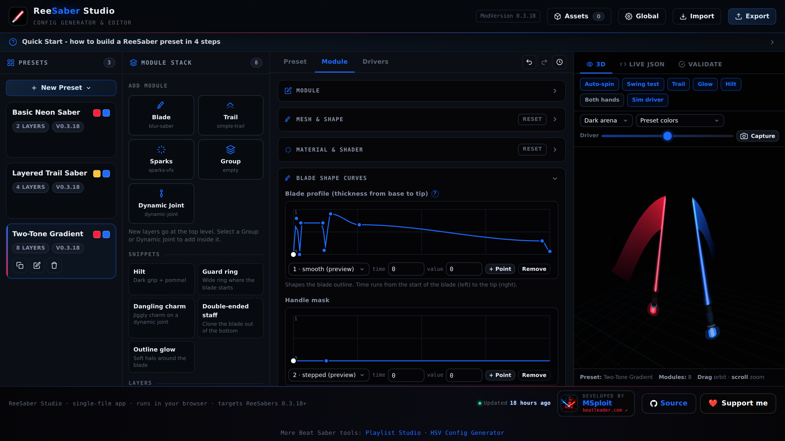

# ReeSaber Studio

> A visual, single-file preset editor and config tool for the [ReeSabers](https://beatleader.wiki/en/reesabers/start) Beat Saber mod.

**Live app:** https://spanky3651.github.io/ReeSaber-Studio/

ReeSaber Studio lets you build and edit ReeSabers presets in your browser: stack and nest layers, tune materials, wire up gameplay-reactive drivers, add your own textures, and export a ready-to-use `.json` or `.reesaber` file. No build step, no install, no backend. The whole app is one HTML file.

The ReeSabers in-game Preset Editor only runs on PC, so Studio is also the way to edit presets for **Quest**: plug the headset in, open the presets on it, change them, and push them back over USB.



---

## Features

- **Quest over USB.** In Chrome or Edge on a computer, connect a Quest (Developer Mode on) and Studio lists the presets in its ReeSabers folder. Open one, edit it, and push it back. Every push shows what changes compared with the copy on the headset first. Built on [ya-webadb](https://github.com/yume-chan/ya-webadb), the same approach as the HSV Config Generator.
- **Presets.** Create, duplicate, rename and delete presets, or start from a template (Basic Neon, Reactive Velocity, Layered Trail, Driver test).
- **Layer tree.** Use **Add layer** for Blade (`blur-saber`), Trail (`simple-trail`), Sparks (`sparks-vfx`), Group (`empty`) and Dynamic Joint (`dynamic-joint`) layers. Select a Group or Dynamic Joint first to nest layers inside it. Reorder (drag, the ⋯ menu, or Alt+Up / Alt+Down), mute and delete at any depth.
- **Curve and gradient editors.** Drag points to shape the blade profile, handle mask and every mapping curve, and edit color gradients along the blade or trail. Double-click adds a point, Delete removes one.
- **Drivers.** Bind a live game value to a layer's color, alpha and scale using the same curve and gradient editors. Drivers are edited as the real ReeSabers objects, so nothing is simplified away.
- **Driver test preset.** One glowing band per driver number (1 to 9). Load it in game, play a song, and see which band reacts to what.
- **Layer tools.** Duplicate, copy and paste layers (also between presets), drag and drop them into or out of groups, and solo a layer in the preview.
- **Snippets.** Drop-in mini builds: hilt, guard ring, dangling charm on a dynamic joint, double-ended staff (a clone that stays linked when you reorder), and outline glow.
- **Undo, redo and checkpoints.** Ctrl+Z / Ctrl+Shift+Z for the last 60 changes, plus named checkpoints saved with your work.
- **Textures.** Upload `.png` / `.jpg` / `.webp` files and pick them in a layer's texture slots (main, glow, normal and other maps on blades; texture and opacity on trails). They are embedded on export. Oversized or odd-sized textures are flagged and can be shrunk or resized to a power of two in one click. A built-in maker generates trail textures (fades, streaks, noise, stripes, glow core) and a sprite-sheet builder packs animation frames and fills in the animation layout.
- **Live 3D preview.** A Three.js viewport renders the whole layer tree with the real blade silhouette from its profile curve, gradients, textures, clones and nested joints. **Swing test** slashes the sabers so trails streak, sparks burst on cuts and dynamic joints jiggle. Drag its edge to resize it, expand it to fill the screen, fit the saber in view, switch camera views, and show a note block for scale. Switch backdrops (dark, bright, neon) and color schemes, scrub driver values by hand, and solo a layer. Preview hands, colors and the optional preview model only affect the viewport.
- **Combined presets.** ReeSabers can stack several presets on one saber. Preview them together (say a hilt preset plus a blade preset), or show a different preset in each hand.
- **Compare versions.** Imported presets remember the original file, and you can pin any version. See a list of every change, view the saved version and your edit side by side, or revert.
- **Showcase capture.** Save a transparent PNG, a 480×360 gallery thumbnail, or a looping GIF (360° spin or swing) for Discord or Reddit.
- **Performance estimate and explain.** A Light / Medium / Heavy estimate for PC or Quest from mesh detail, particles and texture memory, and a plain-English breakdown of any preset's layers.
- **Validation.** Live JSON inspector, usual ranges on every slider with per-panel Reset, and checks for empty presets, missing textures, unknown module types, out-of-range values and texture sizes, plus a pre-export check. Click a warning to jump to its layer. Unusual values that came from an imported file are kept and listed as notes, never changed for you.
- **Lossless import.** Open a ReeSabers `.json` or `.reesaber` bundle and export it again without changing anything you did not edit (driver curves, texture names, unknown fields and `ModVersion` are all kept).
- **Autosave.** Your work is saved in the browser (IndexedDB) and restored on your next visit. You can also download a full Studio project file.
- **Drop files anywhere.** Drop a `.reesaber`, a preset or project `.json`, a `.zip` of presets, or textures and preview models onto the page. Custom Sabers `.saber` files are recognised and explained (they are Unity asset bundles for a different mod and can't be converted).
- **Save to your Presets folder.** In Chrome and Edge, link `UserData/ReeSabers/Presets` once and save straight into it, optionally keeping the active preset synced while you edit.
- **Share links and gallery.** Copy a link with the whole preset packed inside it, open community presets from the built-in gallery, or link to a preset on GitHub with an "Open in Studio" URL.
- **Works on phones and tablets.** Below 1100px wide the app switches to a tabbed layout with a bottom tab bar. (Quest over USB needs a computer.)

---

## Getting started

Nothing to install. Open the [live app](https://spanky3651.github.io/ReeSaber-Studio/), or download [`index.html`](index.html) and open it in a modern browser (Chrome, Edge, Firefox). An internet connection is only needed for the 3D preview (Three.js loads from a CDN); editing, import, export, validation and Quest over USB work offline.

---

## How to use it

1. **Pick a starter.** Use **New Preset ▾** for a template, or start blank.
2. **Stack layers.** Use **Add layer** and pick a module or snippet. To nest, select a Group or Dynamic Joint in the stack first; new layers then go inside it. Click a layer's dot to mute it.
3. **Tune it.** Select a layer and open its panels to shape mesh, material, color override and transform.
4. **Add drivers.** On the **Drivers** tab, make a layer react to gameplay, for example a trail that brightens as you swing faster. Drag the **Driver** slider under the preview to test it, and turn on **Swing test** to see trails, sparks and jiggle in motion.
5. **Add textures (optional).** Open **Assets**, drop in a `.png` / `.jpg`, then pick it in the layer's **Textures & Assets** panel.
6. **Check and export.** When the **Validate** tab is green, use **Export**:
   - **Download .json**: one file with textures embedded in `BinaryAssets`.
   - **Download .reesaber**: a zip with `preset.json` plus a `textures/` folder.
   - **All as .zip**: every preset in one download.

   Then pick it in the ReeSabers menu in game:

   | | Presets folder | Shortcut in Studio |
   |---|---|---|
   | **PC** | `Beat Saber/UserData/ReeSabers/Presets/` | **Save to folder** (Chrome or Edge) |
   | **Quest** | `ModData/com.beatgames.beatsaber/Mods/ReeSabers/Presets/` | **Quest** button: push over USB |

   A `.json` carries its textures inside, so it's the only file you need on either one. Saber visibility and motion smoothing are ReeSabers' own in-game settings, not part of a preset.

### Quest over USB

1. Turn on **Developer Mode** for the headset in the Meta Horizon phone app, and plug it into your computer with a USB data cable.
2. Open Studio in **Chrome or Edge** and click **Quest**, then **Connect**. Pick the headset and allow USB debugging inside it (tick *Always allow*).
3. Open a preset from **On your headset**, or build one. **Push** shows what will change before anything is replaced.
4. In game, re-select the preset in the ReeSabers menu.

If connecting fails with a "claim" or "busy" error, another program (SideQuest, Meta Quest Link, Android Studio or a terminal `adb`) is holding the connection. The **Connection trouble** section in the Quest panel has the commands to free it. If the status says **No answer**, the headset never replied: another Chrome tab that connected to it (HSV Config Generator, Playlist Studio, MBF) is the usual cause, so close it, unplug and replug, and connect again. **Approve in headset** means it is waiting for you to allow USB debugging inside the headset.

---

## Sharing presets

- **Share link:** Export → **Copy share link** packs the preset into the URL (textures aren't included; share a `.reesaber` for textured sabers).
- **Gallery:** New Preset ▾ → **Browse the gallery**. To add yours, [fill in the gallery form](https://github.com/Spanky3651/ReeSaber-Studio/issues/new?template=gallery-submission.yml) (no coding needed) and attach the preset plus a thumbnail from **Capture → Gallery thumbnail**. Pull requests that add the file, the 480×360 PNG and an entry in [`gallery/index.json`](gallery/index.json) work too.
- **Open in Studio links:** link to a preset hosted on GitHub like this:

  ```
  https://spanky3651.github.io/ReeSaber-Studio/?src=https://raw.githubusercontent.com/<user>/<repo>/main/<preset>.json
  ```

  Studio asks before loading it, and only accepts `raw.githubusercontent.com`, `gist.githubusercontent.com` and this site. Add `&utm_source=<site>&utm_campaign=<post>` when posting the link so the visit shows up in the stats.

---

## File format

Studio reads and writes the real ReeSabers preset structure:

```jsonc
{
  "ModVersion": "0.3.18",
  "Version": 1,
  "RootSettings": { "Type": 0 },
  "LocalTransform": { "Position": {}, "Rotation": {}, "Scale": {} },
  "Modules": [
    { "ModuleId": "reezonate.blur-saber", "Version": 2, "Config": {}, "Children": [] }
  ],
  "BinaryAssets": {
    "Textures": [ { "AssetName": "Dragon.png", "Data": "<base64>" } ],
    "Geometry": []
  }
}
```

Textures are referenced from a layer's config by file name (for example `TexturesSettings.mainTextureId` on blades and `generalSettings.customTextureId` on trails). Imported presets keep their own `ModVersion`; new presets use `0.3.18`.

Drivers are stored by number (`valueType`). ReeSabers doesn't publish which number is which game value, so Studio's names (Score, Velocity and so on) are marked as guesses, and any number can be typed in directly. Imported numbers are never changed. The **Driver test preset** is there to settle it: if you confirm what a number does, please [open an issue](https://github.com/Spanky3651/ReeSaber-Studio/issues).

Curve interpolation types are also numbers. The preview draws 0 as linear, 1 as smooth and 2 as stepped; that is an approximation of the mod's own maths.

---

## Project structure

```
ReeSaber-Studio/
├── index.html        # the whole app (served by GitHub Pages)
├── gallery/          # community presets: index.json, preset files and thumbnails
├── .github/ISSUE_TEMPLATE/
│   └── gallery-submission.yml   # the "submit a preset" form
├── docs/
│   └── screenshot.png   # README image, also used as the link preview image
├── README.md
├── LICENSE
└── .gitignore
```

## Tech

- Vanilla JavaScript, HTML and CSS in one file. No framework, no bundler.
- [Three.js](https://threejs.org/) r128 from a CDN for the preview, plus its OBJ/GLTF loaders.
- [ya-webadb](https://github.com/yume-chan/ya-webadb) (adb 2.6.4, adb-daemon-webusb 2.3.2, adb-credential-web 2.1.0), built into the page as one matched release, for Quest over USB.
- Privacy-friendly page counts with [GoatCounter](https://www.goatcounter.com/) (no cookies).

## More tools

Other free, single-file Beat Saber tools by MSploit:

- **[Playlist Studio](https://spanky3651.github.io/Playlist-Studio/?utm_source=github&utm_campaign=readme-reesaber-studio)** - Build Beat Saber playlists from BeatLeader and BeatSaver, with your own scores on every map, PP math, and a ready-to-play `.bplist` export.
- **[HSV Config Generator](https://spanky3651.github.io/HSV-Config-Generator/?utm_source=github&utm_campaign=readme-reesaber-studio)** - A visual editor and live simulator for HitScoreVisualizer configs, with push-to-Quest over USB.

## Acknowledgements

- The [ReeSabers](https://beatleader.wiki/en/reesabers/start) mod by the BeatLeader team.
- Community presets such as [iza-ttv/ReeSabers-presets](https://github.com/iza-ttv/ReeSabers-presets) used as schema references.

This is a community tool and is not affiliated with or endorsed by the ReeSabers authors, BeatLeader or Beat Games.

## License

Released under the [MIT License](LICENSE).
